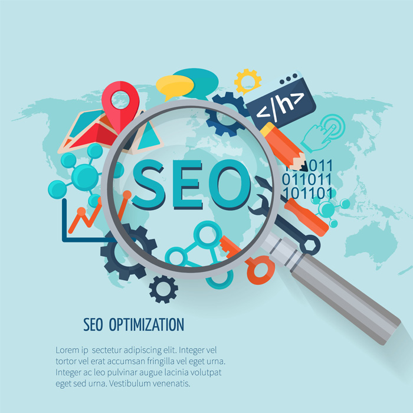
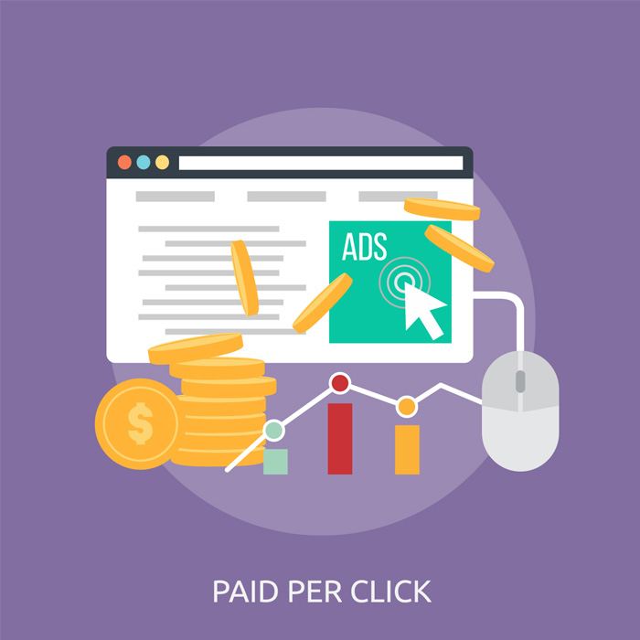
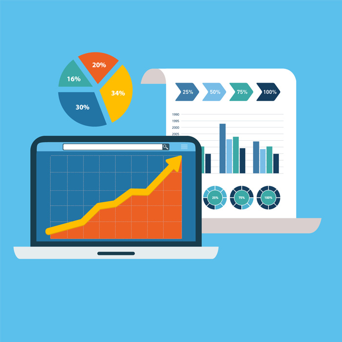
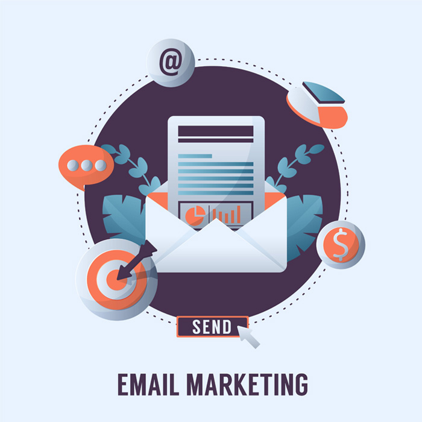
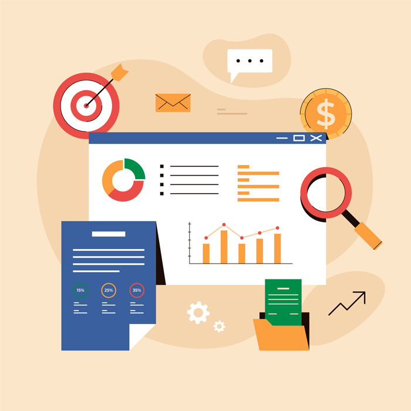
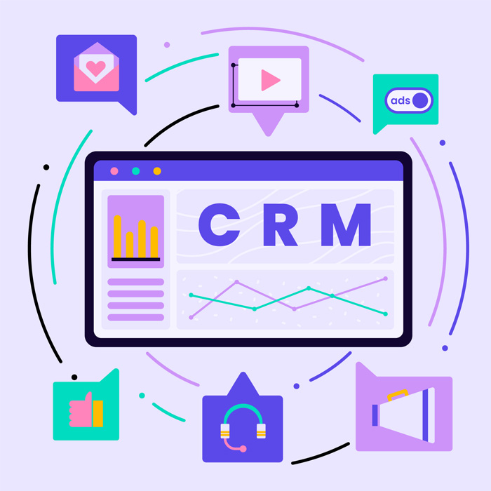

## Digital Growth Marketing Services

Leverage our full suite of digital growth marketing services from content infused website development to SEO to paid campaign management and more and get your business on the fast track.

## Website Development

1

### Wireframe and CMS

Design website wireframes that translate your business vision into design artefacts. Develop the sitemap, page layouts, landing page designs, and more.

2

### Development and Tuning

Build your website in accordance with the overall plan and design strategy. Create search engine optimized original content for the website.

3

### QA and Monitoring

Run tests and reviews prior to launch to iron out any defects or deficiencies. Continuously monitor and update the website as per user needs and search engine and technology changes.

## Search Engine Optimization (SEO)

1

### On-Page SEO

Align your content with what users are seeking while satisfying search engine ranking factors. Improve page speed, utilize canonical URLs, make appropriate use of redirects, implement SSL, adopt schemas

2

### Off-Page SEO

Seek and acquire new valuable inbound links. Optimize your website to appear in relevant local search results.

3

### eCommerce SEO

Ensure that your online store is optimized for the right keywords with buying intent. Audit your store to ensure that it conforms to SEO best practices.

## Creative Design Services

1

### Graphics Design

Build a better brand through UI/UX design, illustrations, image editing, and more. Includes ad creative,

2

### Social Media Design

Create social media creatives and landing pages that boost engagement and website visits.

3

### UI/UX Design

Create functional, visually appealing, and user-friendly digital products by combining user experience research with user interface design.

## Messaging

1

### Messaging Templates

Create memorable, meaningful messages that resonate with your audience.

2

### Value Focused

Highlight the value of your products and services, going beyond actual words and phrases to feelings and emotions, both the literal language and subtext of your communications.

3

### Brand Aligned

Our marketing messaging will stay in sync with your brand voice and establish the right tone and attitude. This will cover social media posts, promotional copy, website copy, email campaigns, and calls-to-action.

## Paid Advertising

1

### Campaign Setup

Setting up ad campaigns. Curating ad content and creatives for ads.

2

### Performance Optimization

A/B testing across ad formats and creative options. Tracking and optimizing campaign performance. Reporting on ad campaign progress made.

3

### Audience Development

Running tests and reviews prior to launch to iron out any defects or deficiencies. Continuously monitoring and updating the website as per user needs and search engine and technology changes.

## Google Analytics

1

### Google Analytics audit

Plug any gaps in your data collection process, audit tracking code, account configuration, data integrity, and conversion tracking.

2

### Google Analytics account setup

Setup and implementation of a new or existing Google Analytics account and properties, ensuring that it is correctly configured with the right data.

3

### Google Analytics consulting

Based on data goals that we will help you determine, we will interpret current data, aggregate data across multiple websites, create customizable reports, set up conversion funnels, and more.

## Email marketing

1

### Email Strategy

Executing cost-effective strategies for larger email audiences. This will run the whole gamut of email marketing from creating the first draft to sending out the final emails.

2

### Lead Nurture

Deploying automated email drip campaigns through workflow tools. Creating and growing the email list through opt in strategies.

3

### Email Tracking

Monitoring email campaign performance and reporting. Obtaining valuable feedback to customize and improve campaigns.

## Conversion Rate Optimization

1

### Funnel Optimization

Discovering marketing funnel gaps that lead to dropped conversions. Uncovering user feedback through polls, questionnaires, and interviews.

2

### Conversion Optimization

Setup and implementation of a new or existing Google Analytics account and properties, ensuring that it is correctly configured with the right data.

3

### A/B Testing

Conducting extensive and in-depth website analysis. Running A/B tests by experimenting with CTAs, content variants, and landing page variants. Making changes to the website and landing pages to boost effectiveness.

## CRM and Marketing Automation

1

### Lead Generation

Setting up workflows, capture forms, and nurturing sequences to move leads through the sales funnel. Connecting with potential customers from their first interaction all the way to conversion.

2

### Lead Conversion

Improving conversion rates with smarter strategies, sharper insights, and performance marketing you can measure.

3

### Customer Retention

Deepening engagement, boosting lifetime value, and increasing profitability through data-powered retention strategies.
