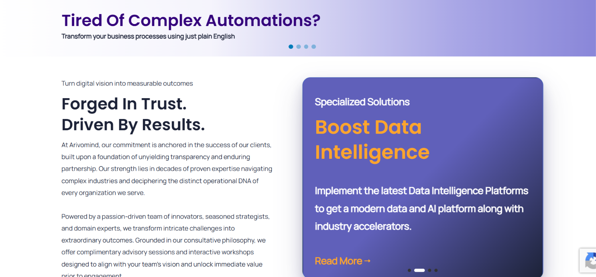

[Visit site](https://arivomind.com/)

## AI and Automation

Arivomind is a provider of AI and automation services that turn digital vision into measurable outcomes.

[Learn more](/contact-us/)

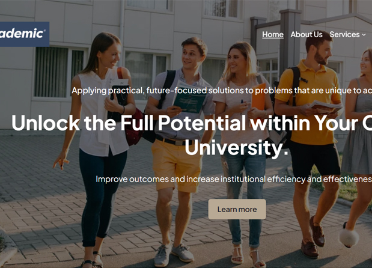

[Visit site](https://pracademicinc.com/)

## Consulting Website

pR3academic is a provider of comprehensive and flexible consulting services for colleges and universities. This website includes e-commerce.

[Learn more](/contact-us/)

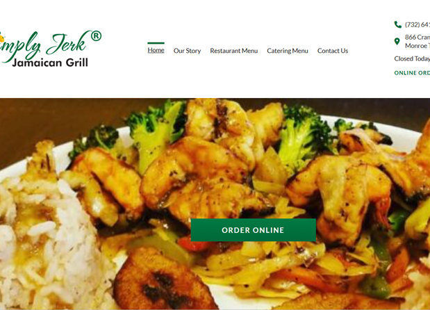

[Visit site](https://simplyjerkjamaicangrill.com/)

## Restaurant Website

Simply Jerk® Jamaican Grill is a family-owned and operated restaurant that was created by the owners of Jamaican Delight and The Green Grotto restaurants, which were staples in the heart of New Brunswick for 15 years.

[Learn more](/contact-us/)

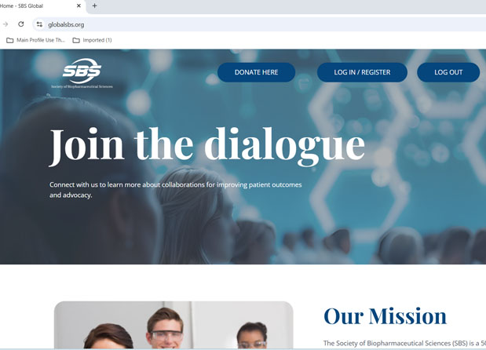

[Visit site](https://globalsbs.org/)

## Membership Management Platform

A comprehensive WordPress membership platform for SBS Global that combines event management with subscription-based memberships. The platform serves as a professional community hub with three membership tiers. The system integrates event ticketing with membership benefits, where members receive discounted access to both webinars and in-person events.

[Learn more](/contact-us/)

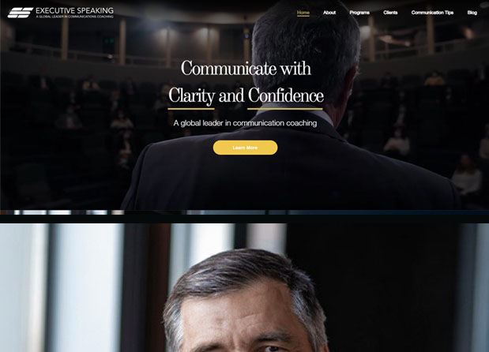

[Visit site](https://executivespeaking.net/)

## Communication coaching

Website for a global leader in communication coaching. You get the expertise of a coach who can pinpoint your strengths, show you your opportunities, and give you the tools that will empower you to take your communication skills to the next level – authentically.

[Learn more](/contact-us/)

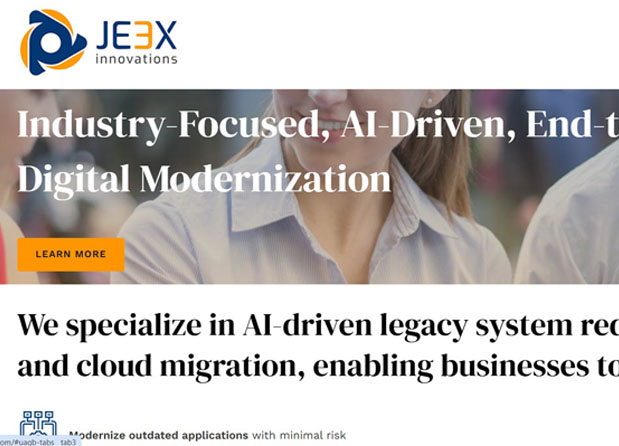

[Visit site](https://jeexinnovations.com/)

## Digital Modernization

Website for provider of industry-focused, AI-driven, end-to-end digital modernization including legacy system redevelopment and cloud migration.

[Learn more](/contact-us/)

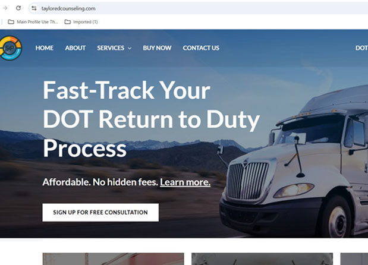

[Visit site](https://tayloredcounseling.com/)

## Substance Abuse Evaluations

Website for provider of substance abuse counseling services. This website includes e-commerce and e-signing of documents as additional features.

[Learn more](/contact-us/)

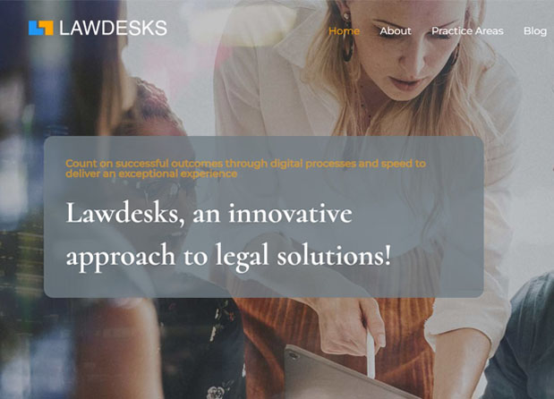

[Visit site](https://lawdesks.com/)

## Legal services

Website for an innovative provider of legal solutions.

[Learn more](/contact-us/)

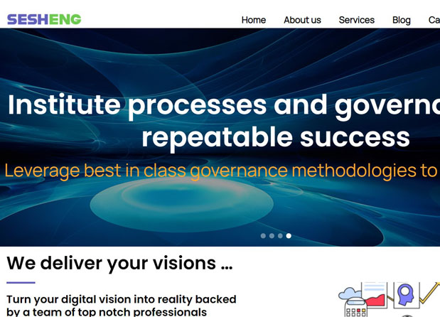

[Visit site](https://seshng.com/)

## Digital technology services

Website for a next-generation provider of digital technology services.

[Learn more](/contact-us/)

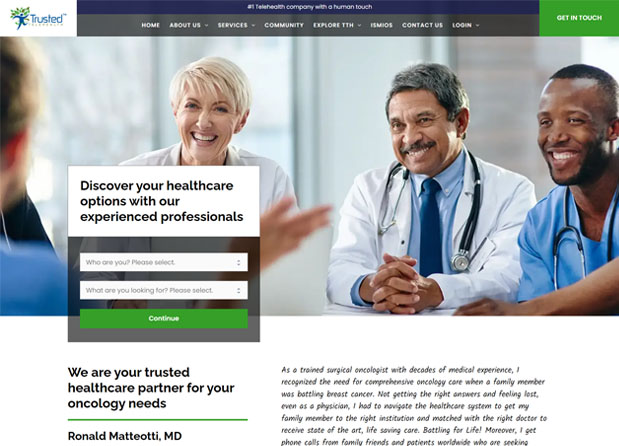

[Visit site](https://tth.ai/)

## Second Opinion Services

Website for an innovative provider of second opinion healthcare services

[Learn more](/contact-us/)

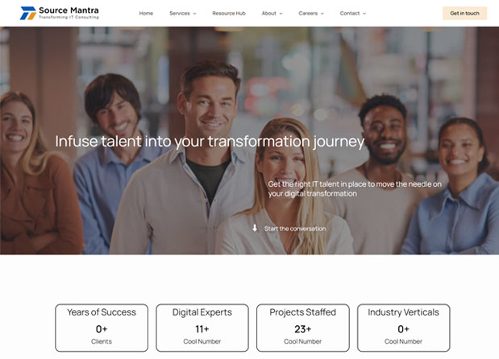

[Visit site](https://sourcemantra.com/)

## IT Staffing Services

New website for an established IT Staffing and Consulting services provider

[Learn more](/contact-us/)

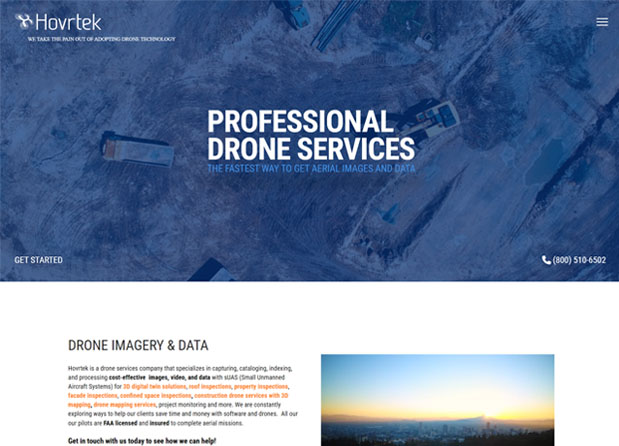

[Visit site](https://hovrtek.com/)

## Drone Services

Website for an innovative provider of drone services

[Learn more](/contact-us/)

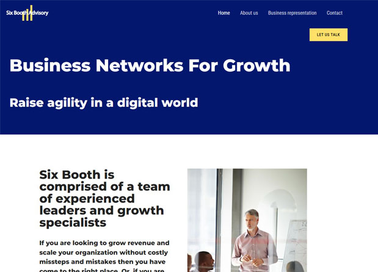

[Visit site](https://sixbooth.com/)

## Business Representation USA

Website for an emerging startup that helps small to mid-sized companies achieve sustainable growth and profits in the US through business representation.

[Learn more](/contact-us/)
