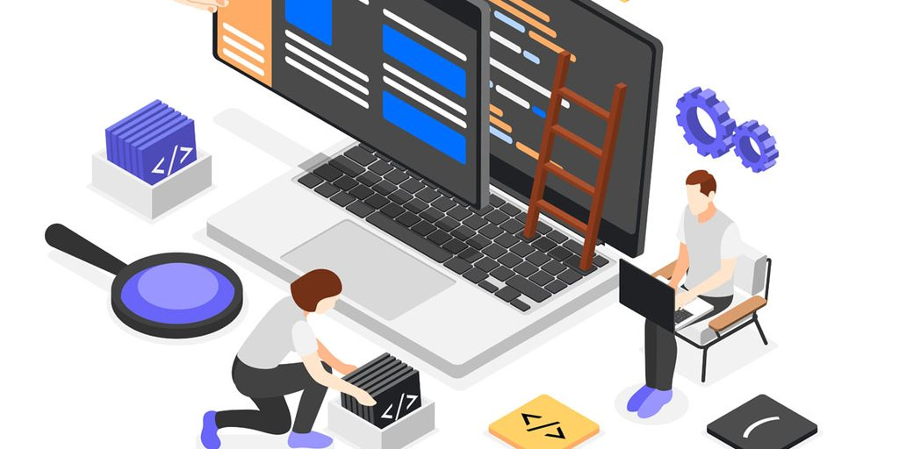

# AI-Assisted Website Development: A Smarter Way to Build

Two things are reshaping website development right now: the rise of AI tools that can generate design and code on demand, and WordPress as the platform that professional websites run on. Separately, each has value. Together, they produce something better than neither delivers alone—sophisticated, custom websites built faster and at lower cost than traditional development.

## The Traditional Challenge: Custom Takes Time

For years, the tradeoff in web development was straightforward: the more custom and distinctive your website, the more it cost and the longer it took. A generic template could be up in days. Something genuinely unique—built to reflect your brand, your workflow, your business—required significant developer hours, and those hours translated directly into client cost.

## That math has shifted. Where AI Changes the Equation

AI tools can now generate production-relevant HTML, CSS, and JavaScript in minutes. A complex layout that might have taken a developer several hours to code from scratch can begin as AI-generated output that's ready to be refined and implemented.

This isn't about replacing development expertise—it's about changing where that expertise is applied. Instead of spending hours on foundational code, experienced developers spend their time on what requires judgment: making the code work correctly in context, integrating it with your platform, and ensuring it performs reliably for your specific needs.

The result is more development time spent on refinement and less on repetitive construction. That difference reaches the client as faster delivery and more competitive cost.

## The Developer's Role: Where Expertise Still Matters

AI output is a starting point, not a finished product. Adapting generated code for real-world use on WordPress requires skills that no AI tool replaces:

- **Style scoping:** Code generated in isolation needs to be contained so it doesn't interfere with the rest of your site. This requires deliberate, platform-aware implementation.
- **Platform compatibility:** WordPress has its own architecture, and code that works in isolation doesn't automatically work within it. Making the two integrate cleanly is developer work.
- **Architecture integration:** Your website isn't just a collection of pages—it's a system. Custom code needs to connect to your existing structure, your plugins, your workflows. That connection requires understanding the whole, not just the part.
- **Edge case handling:** What happens when something goes wrong? When a user takes an unexpected path? When content is longer or shorter than anticipated? AI generates code for the intended scenario. Developers account for what happens beyond it.

The principle is simple: AI accelerates, the developer ensures it works. Both are necessary.

## What the Client Gets

From a business owner's perspective, this approach changes what's possible within a given budget:

- **Faster delivery:** Projects move from concept to completion in less time, which means your website starts working for you sooner.

- **More possibilities:** Features and design elements that might have been out of reach at your budget become feasible when development time is used more efficiently.

- **Custom results:** Your website reflects your brand and your business specifically—not a template adjusted to fit, but something built for you.

- **Full ownership:** The result lives on WordPress, which you own and control. No platform dependency, no monthly subscription holding your site hostage, no limitations on what you can do with it in the future.
