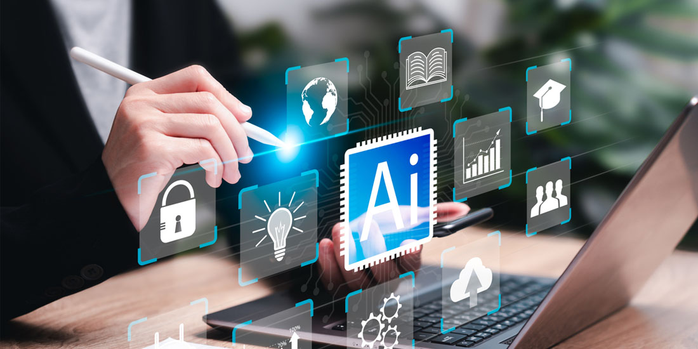

# Marketing Nirvana with AI

To say that marketing and technology are inseparable today is stating the obvious. According to a recent survey, martech accounted for 30% of marketing budgets in 2023.

But there used to be a time when marketing was almost entirely defined by storytelling and creativity. However, some years back, the tables turned on marketers and they found out that they also needed to be programmers, statisticians, technologists, and data scientists. Roles that not all were suited for. The shift was of course driven by the fact that consumers were rapidly moving online.

### Problem of excess

That is when marketing technology platforms started to make their entry: for email marketing, marketing automation, digital advertising, social media management, SEO, content management, and so on. Pretty soon, marketers found themselves inundated with data and platforms. Technology tantalizingly offered the means to move closer to the end goal: get the right message to the right user at the right time on the right channel and on the right device.

But marketers realized that the task was easier said than done. They were dealing with a problem of excess. Too much data. Too many variables. Too many platforms. Too many channels and devices. Attribution became a challenge. Did the conversion happen because of the Facebook ad or the email campaign or a TV/radio ad spot?

At the same time, consumers became inundated with irrelevant messages across channels and began to opt out or ignore them altogether. Personalization became key to staying relevant. But it is one thing to personalize communications across a few tens to hundreds of users. But step into the thousands to millions of users and more and personalization started to look out of reach.

### AI as the solution

Artificial Intelligence (AI) solutions are doing their magic by analyzing the data, learning the patterns, executing campaigns autonomously, continuously testing thousands to millions of variables to determine what works best, and learning and continuously improving.

Digital advertising is an example where AI has made a difference. By taking care of the optimization of keywords, ad copy, budgets, and bidding, AI is boosting click-through and conversion. Another example is email marketing with AI handling subject lines, send times, and copy adjustments to maximize open/click rates and conversion.

With chatbots and virtual assistants, AI based marketing is making dramatic gains in customer experience and customer intimacy by making the solution voice and visual enabled.

### Marketers back in control

At the end of the day, AI based marketing platforms are automatically carrying out a lot of the tactical decision making that was thrust on marketers, freeing up their time for more strategic activities.

But the real power of AI may be more personal.

AI is putting marketers back in control. By automating many of the marketing processes, AI is empowering marketers to put on their strategy hats and become true business leaders. It is enabling them to think more clearly, go back to the basics, and come up with creative strategies to drive growth. They can rest assured that AI based marketing can help execute strategy, provide feedback from the market in a manner that is easier to consume, and enable course corrections to be made in near real time.

With AI, it gives power back to marketers. No longer held hostage by technology, they are free to take charge of their destinies. Nirvana looks within reach.
