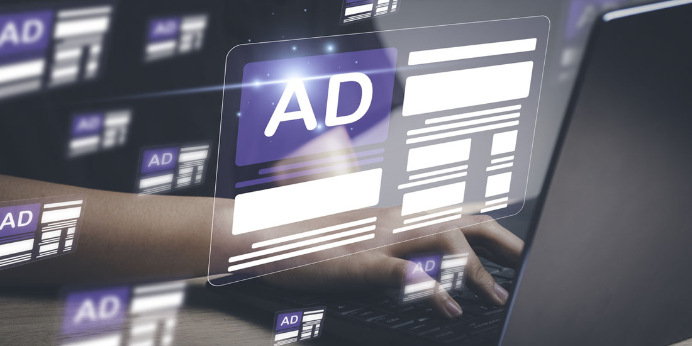

# Search Ads Second After SEO First

Are you looking to get more customers to find your business online? If the answer is yes, then local organic search would likely be the marketing channel to focus on first. Once that is squared away, then it would probably make sense to add other digital marketing channels to the mix. Google search ads should be a top contender for the second place.

Google search ads could be set up with location specific keywords. They could show as ads in the Google Maps interface. So, we could get to run both search ads and Google maps ads in the same campaign.

The first step would be to ensure that a Google Business Profile account has been created with all details added to it including the correct address, opening hours, contact details, quality images, and a well written description. Once the account has been created and fully optimized, the business should start to show up organically within the Google Maps local pack. The higher the rank, the easier it would be for potential customers to find your business online. Getting into the top three slots on the local map would be the best place to be in, but getting there could take some time. Advertising the business on Google Maps would provide a “shortcut” by immediately boosting it to the top of search results (marked as an ad).

### Digital Marketing | Setting Up the Campaign

The path to setting up a successful Google Search ad campaign would run as follows:

**Creating a new campaign on Google ads** with similar keywords bunched together into ad groups and individual ads within each ad group.

**Including keywords that are relevant to local searches** like “near me” or “New York” that relate to the business and its location.

**Creating search ads that promote services** and direct those who click on them to a targeted landing page that is conversion ready.

**Setting up Google Ads conversion tracking** before launching the campaign to be able to accurately gauge and optimize results.

Adding the location asset to the search campaign and linking it to the Google Business Profile account. Location assets would display the business’s address within the search ad. This is a clickable link that would open Google Maps and display the route from the user’s location to the business, which would be especially useful for mobile searches. Local assets would also enable the business location and other information to appear as an ad in Google Maps when users search for physical therapists within the Maps user interface.

It might be a good idea to create and verify a Google Business Profile account for each business location. If there are multiple locations, all the location-specific Google Business Profile accounts could be linked to a single Google Ads account. Adding bid adjustments to bid higher for searches in the right locations would ensure that bids are suitably optimized.

Linking Google Ads and Google Business Profile accounts would also show a promoted pin on the map. When the map is clicked to enlarge the area, the business’s pin would stand out and display in a different color than the standard red pin.

### Digital Marketing | Monitoring Campaign Results

Tracking ads performance in Google search ads would show what is working and what is not and provide a way to continually improve the campaign. There are several search metrics but here are some of the key ones to watch out for.

**Impressions:** Number of times the ad has been displayed or seen.

**Clicks:** Number of times the ad was clicked.

**Cost Per Click (CPC):** Total ad spend divided by the number of clicks.

**Cost Per Conversion:** Total ad spend divided by the number of conversions (or useful outcomes).

**Click-through Rate (CTR):** Total number of clicks divided by total number of impressions.

Search ads would effectively complement the organic local SEO efforts and help further step-up marketing outcomes for the business. If organic local SEO “first” and search ads “second” are the digital marketing channels of choice, then success and growth should follow.
